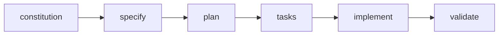

# 🚀 antares


Welcome to **antares** — a spec-driven project where the documentation
comes first and the code follows. ✨

## 📚 Index

- [About](#-about)
- [Getting Started](#-getting-started)
- [Architecture](#-architecture)
- [Documentation](#-documentation)

## 🧭 About

antares keeps a single source of truth in `doc/arch`: every feature
begins life as a spec and flows through a repeatable workflow before any code
is written. 🎯 The payoff is a codebase you can always trace back to a recorded
decision.

## 🛠️ Getting Started

```
speckit status      # where am I in the workflow?
speckit next        # what should I do next?
speckit validate    # check the spec corpus
```

The spec-driven workflow at a glance:



## 🏛️ Architecture

The spec corpus lives under `doc/arch/`, organized by concern:

- 📐 [Architecture Decision Records](doc/arch/adr/)
- 🧬 [Schemas](doc/arch/schemas/)
- 🥒 [Feature specs](doc/arch/specs/features/)
- 🗂️ [Feature working dirs](doc/arch/sdd/)

## 📖 Documentation

- 🤖 `AGENTS.md` — machine-readable project map for agents and automation
- 🧠 `CLAUDE.md` — Claude Code working notes
- 📚 [The full spec corpus](doc/arch/) — the authoritative source of truth

## License

Project licensing is declared in the root `LICENSE` file and via
`project.license` in `doc/arch/speckit.toml`. Inspect the effective posture
with:

```
speckit license show
```

Happy spec-driving! 🚀
