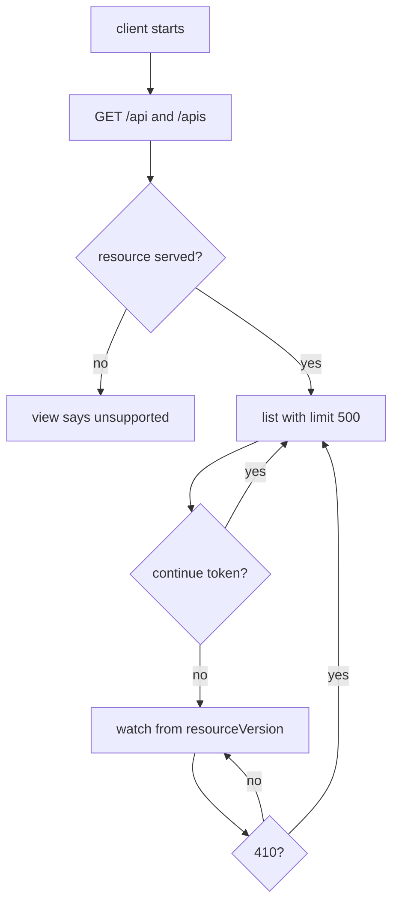

# Kubernetes API compatibility

## Overview

The client speaks to clusters from Kubernetes 1.25 to latest. This document is
the compatibility contract: which API features may be used, which are deferred,
and which versions the floor itself removed.

## Actors

- **The operator**, who points the client at a cluster of any version in range.
- **The client**, which discovers what the server serves instead of pinning
  group versions.
- **The API server**, whose version decides which features exist.

## Floor

The client supports Kubernetes **1.25 through latest**. The floor is a product
decision, not an upstream one: the project maintains three minor releases, so
1.25 is already twelve versions behind support.

Two consequences follow and are not negotiable:

- **No API feature newer than 1.25 becomes the only path.** A newer feature is
  either version-detected or left out until the floor rises.
- **Nothing is pinned to a group version.** The client reads `/api` and `/apis`
  (`src/domain/k8s/discovery.hpp`) and builds paths from what the server says it
  serves, so a version removed upstream does not break it.

## Feature matrix

| Feature | Since | On the floor | Use |
|---|---|---|---|
| `limit` / `continue` | 1.15 | yes | required, every list |
| `as=Table` | 1.15 | yes | optional |
| `as=PartialObjectMetadata` | 1.15 | yes | optional |
| `remainingItemCount` | 1.15 | yes | progress |
| `allowWatchBookmarks` | 1.17 | yes | yes |
| `resourceVersionMatch` | 1.19 | yes | with a pinned version |
| `sendInitialEvents` | 1.32 (beta 1.34) | **no** | deferred |

`sendInitialEvents` is the only gap. It collapses list-then-watch into one
stream, and taking it as the only path would break every cluster below 1.32.
The list-then-watch flow of feature 005 is what runs, and it is correct on both
ends of the range.

## Flow

## Removed in 1.25

The floor itself removed these. A view that renders them must use the
replacement, never the `v1beta1` group:

| Removed | Replacement |
|---|---|
| `policy/v1beta1` PodSecurityPolicy | Pod Security Admission |
| `policy/v1beta1` PodDisruptionBudget | `policy/v1` |
| `batch/v1beta1` CronJob | `batch/v1` |
| `autoscaling/v2beta1` HorizontalPodAutoscaler | `autoscaling/v2` |
| `discovery.k8s.io/v1beta1` EndpointSlice | `discovery.k8s.io/v1` |
| `node.k8s.io/v1beta1` RuntimeClass | `node.k8s.io/v1` |
| `events.k8s.io/v1beta1` Event | `events.k8s.io/v1` |

`events.k8s.io/v1` also renamed fields: `involvedObject` is `regarding`,
`source.component` is `reportingController`, `source.host` is
`reportingInstance`, `count` is `series.count`, `lastTimestamp` is
`series.lastObservedTime`, and `eventTime` replaces `firstTimestamp`. A view over
events reads the new names.

`PodSecurityPolicy` has no replacement object; it is admission configuration now,
so a PSP view either disappears or shows the Pod Security labels on the
namespace.

## How this is honoured

- Feature 005 keeps list-then-watch and reconciles on a 410. No version check is
  needed, because nothing newer than the floor is used.
- Feature 009 pages with `fetchMore` over `limit`/`continue`, which exists
  everywhere in the range.
- A `410 Gone` arrives from two sources — an expired watch history and an expired
  `continue` token, both about five minutes — and both are the same reconciliation
  path.

## Acceptance

- A cluster on the floor serves every view the product offers; nothing newer than
  1.25 is a single path.
- A 410 from an expired watch and a 410 from an expired `continue` token take the
  same reconciliation path.
- A resource absent from discovery is reported as unsupported, not as an error.

## Observability

No signal of its own. The store reports `entries` and `refused`; a discovery miss
logs at `info` with the group and version only.

## If the floor rises

Raising the floor to 1.32 or later makes `sendInitialEvents` available and lets
the initial load skip a round trip. That is a feature of its own, not a tweak:
it needs version detection first, then the streaming path, then a case per
supported floor.
