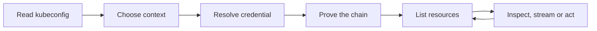

# antares — Product Overview

Functional documentation for antares, written from the user's point of view:
what the product does, who uses it, how the main flow runs, and how we know it
works. Keep this in sync with the executable specs under
`doc/arch/specs/features/`.

## Overview

antares is a desktop manager for Kubernetes clusters. It shows what a cluster
actually holds — workloads, their health, their logs — and lets an operator act
on one without dropping to a terminal and retyping a resource name.

The problem it solves is context loss. A terminal forgets which cluster,
namespace and object it was on between commands, and one wrong `kubectl` against
the wrong context is a real incident. antares keeps that context on screen and
derives every request from it.

The outcome for a user: pick a context once, see the objects, read a log, open a
shell, scale a workload — all from one window that never silently switches
clusters underneath them.

## Actors

- **Operator** — the human running the app. Holds the kubeconfig, chooses the
  context, reads state, and acts on it.
- **kubeconfig** — the local file naming clusters, users and contexts. The only
  source of identity; antares stores no credential of its own.
- **API server** — the cluster's own front door. Owns authorisation: antares
  shows what the credential is allowed to see and surfaces a refusal as a
  refusal.
- **exec plugin** — an optional local process a kubeconfig names instead of a
  token. It prints a credential and antares uses it for that session.

## Main Flow

The path a session takes, from launch to an act on the cluster:

Each step refuses rather than guesses:

- A kubeconfig that fails to parse is named, not skipped.
- A context naming an absent cluster is an error, not an empty view.
- A credential that does not resolve stops before the first request.
- **Prove the chain** is a real request — the API server's version — because a
  client that never spoke to a server has proven nothing.
- A refusal (401, 403) is shown as itself. The app does not retry into a loop.

## Acceptance

Acceptance criteria are executable specifications. The authoritative behaviour
lives in the Gherkin corpus under `doc/arch/specs/features/`; each `.feature`
file there is a scenario the product must satisfy.

- Every user-visible behaviour has a matching feature in
  `doc/arch/specs/features/`.
- A change to the Main Flow above starts with a change to those specs, not to
  the code.
- Run `speckit verify` to check the implementation against the feature corpus.

The current corpus covers the transport under the client
(`http-client-h2.feature`), the kernel engine that carries it
(`kernel-io-engine-kqueue.feature`), and the cluster surface itself
(`kubernetes-api-client-over-the-http-client-port.feature`).

## Observability

How we see antares working:

- **Metrics** — request counts per backend, failure families from the engine,
  and pool reuse. Label sets stay bounded; a resource name never becomes a
  label.
- **Logs** — one line per state change, carrying the context and namespace it
  happened in. A log line that omits the cluster is unreadable once two are
  open.
- **Tracing** — one trace per user action, so a slow list is distinguishable
  from a slow server.

The conventions live in `doc/arch/observability/observability.md`.
