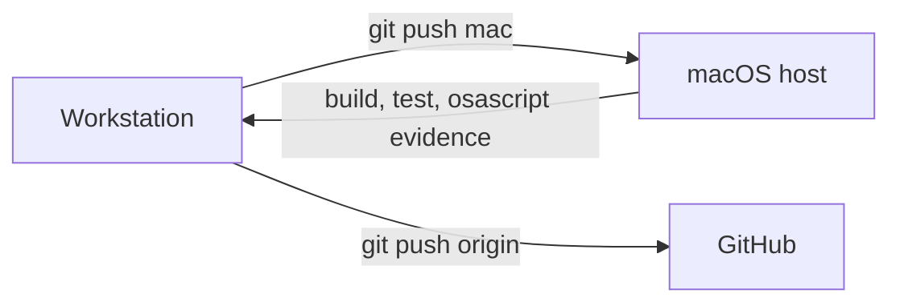

# Dev Loop Runbook — antares

Operational procedure for the inner development loop. Code is authored on the
Linux workstation and validated on the macOS host, because macOS is the first
delivery target (P-05) and the only place a build is evidence.

## Purpose

Keep the edit-compile-test loop short and make every claim about behaviour
checkable. Development uses the `dev` preset (P-08); the optimized
configuration runs only on release.

The macOS host is `farchanjo@192.168.202.241`, checkout at `~/dev/antares`.
AppleScript through `osascript` is the evidence source for anything the exit
code cannot prove.

The workstation is the single hub. It is the only publisher: the host never
talks to GitHub, and GitHub is only reached from here.

The host carries **no** `speckit` and **no** remote of its own. Corpus gates run
on the workstation; the host only builds and tests. The `mac` push lands in the
host checkout through `receive.denyCurrentBranch=updateInstead`.

## Trigger

Run this procedure when:

- A change touches `src/`, `CMakeLists.txt`, `CMakePresets.json` or `tools/`.
- A review asks for proof that a behaviour happens, not only that it compiles.
- The local `speckit validate` is green and the change is ready for evidence.

## Preconditions

- `speckit validate` exits `0` on the workstation.
- `make lint` exits `0` on the workstation.
- The change is committed; the host receives it by push, never by patch.
- The host holds no remote and no upstream branch; it is a sink.
- The host answers and its toolchain resolves: `clang`, `cmake`, `ninja`,
  `sccache`, `ld64.lld`, `osascript`.
- The active feature is selected, so the guard accepts the write.

## Steps

1. Validate the corpus locally: `speckit validate` — must exit `0`.
2. Run the rule checkers locally: `make lint` — must exit `0`.
3. Commit the change.
4. Push it to the host as `main`: `git push mac HEAD:main` — the checkout
   updates in place. Pushing the bare branch name creates a branch the host
   does not check out, because `updateInstead` only acts on the checked-out ref.
5. Over SSH into `~/dev/antares`, configure the dev preset:
   `cmake --preset dev`.
6. Build: `cmake --build --preset dev`.
7. Run the tests: `make test`. It passes `--parallel $(JOBS)` and a CTest entry
   per case, so the suite fans across every core; measured on the 16-core host,
   10 cases run in 0.05 s parallel against 0.26 s serial. Keep per-case entries —
   a single binary per backend loses the failure name and the parallelism both.
   `JOBS=n` in the environment caps the width; unset means every core. A bare
   `ctest --preset dev` is serial, because a preset `jobs` field takes an integer
   and rejects `$penv{JOBS}`, so the Makefile is the supported entry point.
8. Prove the behaviour with AppleScript, for example
   `osascript -e 'return 1 + 1'` for the interpreter and
   `osascript -e 'display notification "…" with title "antares"'` for the
   notification path.
9. Read the sccache counters with `sccache --show-stats` when build time moves
   without a source change.
10. Publish from the workstation only, and only when the loop is green:
    `git push origin HEAD` for the branch, `git push origin main` after merge.

## Verification

- Steps 5, 6 and 7 exit `0`.
- `git push mac HEAD:main` fast-forwards; a rejection means the host tree diverged.
- The AppleScript assertion prints the expected value; a notification appears.
- `sccache --show-stats` reports a hit rate that does not collapse to zero
  after a no-op rebuild.
- No file under `src/domain` names an I/O header after the change.

## Rollback

If a step fails:

1. Stop; do not push a fix on top of a red host.
2. Read the failing step's output in full — the host output, not a summary.
3. Reproduce locally with `cmake --preset dev`.
4. Revert the commit when the cause is the change, or fix the host when the
   cause is the environment.
5. Re-run the procedure from step 1; a run is only valid from a clean start.
