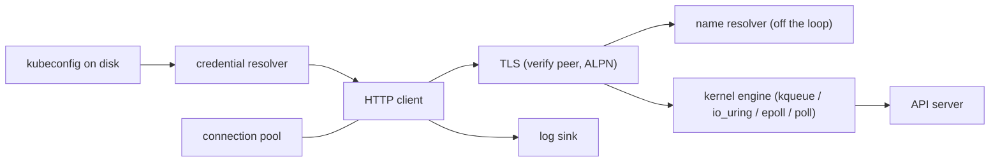

# Threat Model (STRIDE)

The sibling of `privacy-threat-model.md`. STRIDE asks the attack question; the
LINDDUN document asks the privacy one, and each threat below has its privacy
twin there.

The trust boundary is the wire. Everything inside the process is ours; the API
server, the proxy and the name resolver are not. A threat enters here only if
it crosses that boundary, and a mitigation names the code path that stops it,
not an intention.

## Scope

In scope: the client process from the kubeconfig on disk to the socket, across
every layer this repository owns — credential resolution, path build, request
shape, TLS, the HTTP/1.1 and HTTP/2 sessions, the WebSocket upgrade, the pool
and the kernel engine underneath.

Out of scope: the API server, RBAC, admission control and Secret encryption at
rest. The app holds whatever credential the kubeconfig gave it and adds no
privilege of its own.

Each threat carries a stable `TM-NN` id. `speckit validate` checks this document
against the STRIDE template; the privacy model keeps the `PT-NN` ids.

## Data Flow Diagram

The credential enters at the left and must not leave through `log`; the peer is
trusted for nothing until `tls` has verified it.

## Threats and Mitigations

### TM-01 spoofing — a forged server answers the connection

**Category:** spoofing

**Description:** A forged server answers the connection.

**Boundary crossing:** name resolution, TCP accept.

**Mitigations:**
- `SSL_CTX_set_verify` runs with `SSL_VERIFY_PEER` and the default trust paths (`src/adapters/http/tls_context.cpp`).
- ALPN is decided from the server list, never assumed.

### TM-02 spoofing — a redirect bounces the client to an untrusted origin

**Category:** spoofing

**Description:** A redirect bounces the client to an untrusted origin.

**Boundary crossing:** 3xx response.

**Mitigations:**
- the hop count is bounded by `Limits::maxRedirects` (`src/domain/http/limits.hpp`).
- the credential is dropped on a cross-origin hop unless `forwardAuth` is set.

### TM-03 tampering — a middlebox rewrites the ciphertext

**Category:** tampering

**Description:** A middlebox rewrites the ciphertext.

**Boundary crossing:** TLS record layer.

**Mitigations:**
- TLS 1.2 is the floor and the negotiated version is read back, never presumed.
- h2 frames are length-checked before a payload is sized.

### TM-04 tampering — a body drives an allocation past memory

**Category:** tampering

**Description:** A body drives an allocation past memory.

**Boundary crossing:** response body.

**Mitigations:**
- `Limits::maxBodyBytes` caps the body.
- `Limits::maxHeaderBytes` caps the head.

### TM-05 tampering — a mangled kubeconfig points at an attacker cluster

**Category:** tampering

**Description:** A mangled kubeconfig points at an attacker cluster.

**Boundary crossing:** `KUBECONFIG` file.

**Mitigations:**
- the document is parsed into typed values (`src/adapters/k8s/kubeconfig_loader.cpp`).
- a context naming an absent cluster is a typed error, not a silent default.

### TM-06 repudiation — the operator cannot prove which call was made

**Category:** repudiation

**Description:** The operator cannot prove which call was made.

**Boundary crossing:** outbound request.

**Mitigations:**
- method and URL are logged at `trace`.
- the body is not logged, so a secret never reaches a log sink.

### TM-07 repudiation — a replayed watch looks like new events

**Category:** repudiation

**Description:** A replayed watch looks like new events.

**Boundary crossing:** watch framing.

**Mitigations:**
- the resource version rides every event.
- the caller sees the bookmark, so a resume is provable.

### TM-08 information-disclosure — a bearer token lands in a URL or a log

**Category:** information-disclosure

**Description:** A bearer token lands in a URL or a log.

**Boundary crossing:** request line.

**Mitigations:**
- the credential is resolved once per context and travels in a header.
- only the auth kind is logged.

### TM-09 information-disclosure — a pooled connection keeps a stale identity

**Category:** information-disclosure

**Description:** A pooled connection keeps a stale identity.

**Boundary crossing:** connection reuse.

**Mitigations:**
- a connection is bound to the authority and the credentials that opened it.
- a different authority opens a different connection.

### TM-10 information-disclosure — an error message leaks a host or a path

**Category:** information-disclosure

**Description:** An error message leaks a host or a path.

**Boundary crossing:** failure path.

**Mitigations:**
- `IoError` carries the `errno` value and not a formatted system string.
- the Kubernetes `Status` is mapped to a typed error, not echoed.

### TM-11 denial-of-service — an idle peer pins a descriptor

**Category:** denial-of-service

**Description:** An idle peer pins a descriptor.

**Boundary crossing:** pool.

**Mitigations:**
- per-host idle ceiling and a read deadline (`src/domain/http/timeouts.hpp`).
- the idle timer closes the socket, it does not park it.

### TM-12 denial-of-service — one connection starves the rest

**Category:** denial-of-service

**Description:** One connection starves the rest.

**Boundary crossing:** h2 multiplexing.

**Mitigations:**
- `Limits::maxStreamsPerConnection` bounds the concurrency of one connection.

### TM-13 denial-of-service — a name lookup blocks the loop

**Category:** denial-of-service

**Description:** A name lookup blocks the loop.

**Boundary crossing:** DNS.

**Mitigations:**
- resolution runs off the loop thread.
- the lookup is bounded by a watchdog; the loop never waits on a resolver.

### TM-14 elevation-of-privilege — a kubeconfig `exec` block runs code

**Category:** elevation-of-privilege

**Description:** A kubeconfig `exec` block runs code.

**Boundary crossing:** credential plugin.

**Mitigations:**
- the plugin is invoked with the declared arguments.
- its output is parsed as a credential document, never evaluated as shell.

### TM-15 elevation-of-privilege — a namespaced call hits the wrong object

**Category:** elevation-of-privilege

**Description:** A namespaced call hits the wrong object.

**Boundary crossing:** path build.

**Mitigations:**
- the path is built from a `GroupVersionResource` value plus an optional namespace (`src/domain/k8s/api_path.cpp`).
- the caller never concatenates a segment.

### TM-16 elevation-of-privilege — a retried write applies twice

**Category:** elevation-of-privilege

**Description:** A retried write applies twice.

**Boundary crossing:** retry policy.

**Mitigations:**
- a write retries only when marked idempotent.
- a read retries only on a retryable status.

### TM-17 denial-of-service — the object count exhausts memory

**Category:** denial-of-service

**Description:** A peer with many objects, or with oversized labels and names, exhausts memory by count, not by one oversized body.

**Boundary crossing:** list and watch response bodies.

**Mitigations:**
- a stored object is a projection keyed by uid, not a full document; annotations and `managedFields` are decoded and never retained (FR-002).
- an admitted entry costs at most 1 024 bytes: labels truncate at 16 entries or 256 bytes, and an oversized name refuses the object (FR-003).
- a scope admits at most 50 000 entries and the store at most 100 000 across at most 32 scopes; past a ceiling the object is refused and counted, so the store stays under 100 MiB (FR-004).
- a relist is paginated and reconciles in place, so a 410 never holds two copies of a scope (FR-007).
- `Limits::maxBodyBytes` bounds one response and `limit` bounds one relist page; the store ceilings bound what is retained.

## Residual Risks

A hostile API server is trusted to describe itself: discovery, `Status` reasons
and scale subresources are believed once TLS holds. A server that lies about its
own resources produces wrong paths, not a compromised client.

The trust store is whatever the operator supplied. A kubeconfig that points at
a bundle the operator did not mean is not detected here; TM-05 covers only a
malformed one.
